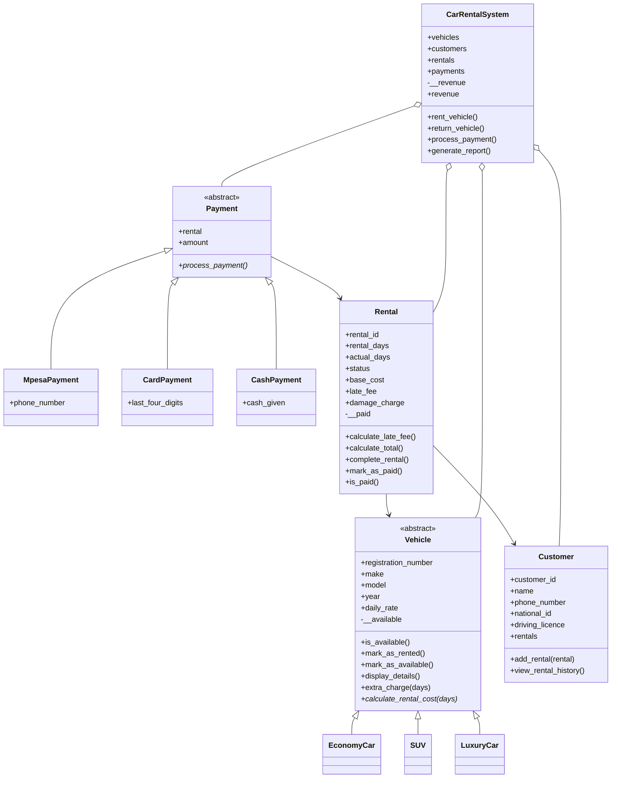

# RentFlow – Car Rental Management System

**RentFlow** is a car rental management system built in Python using Object-Oriented Programming. It was designed for **SafariDrive Rentals**, a growing Kenyan car rental company that used to track everything by hand in notebooks and spreadsheets. RentFlow replaces that manual process with a program that manages vehicles, customers, bookings, payments and returns, and gives staff quick answers to everyday questions.

This is my Python OOP capstone project. It applies abstraction, inheritance, polymorphism and encapsulation to a real business problem.

---

## The Real-World Problem

As the SafariDrive fleet grew, staff struggled to answer simple questions from paper records:

- Which vehicles are available right now?
- Which vehicles are rented, and who has them?
- How long has each vehicle been out?
- How much does a customer owe, and have they paid?
- Was a vehicle returned late?
- How much money has the business made?

Manual records are slow to search, easy to get wrong, and make it hard to enforce rules such as "a rented car cannot be rented twice" or "a rental cannot be paid for twice". RentFlow answers all of these questions from one place. Every figure in its management report is calculated from the real objects in the system, never typed in by hand.

---

## Features

- **Fleet management:** add vehicles of three types (Economy, SUV, Luxury) and list the ones that are available.
- **Search:** filter available vehicles by type and maximum daily rate.
- **Customer registry:** register customers (a driving licence is required) and keep each customer's rental history.
- **Rentals:** rent a vehicle, with automatic cost calculation that depends on the vehicle type.
- **Returns:** record the actual days kept, add a late fee and an optional damage charge, and free the vehicle again.
- **Payments:** pay the final bill by M-Pesa, card or cash. Revenue grows only when a payment succeeds.
- **Receipts:** itemised receipts, including a service charge (SUV) or insurance (Luxury) line where it applies.
- **Management report:** vehicle, customer, rental and revenue totals, plus a count by vehicle category.
- **Business rules:** ten rules are enforced with clear error messages, and the demo shows them being caught without crashing.

---

## Pricing Rules

| Vehicle type | Rental cost |
|---|---|
| `EconomyCar` | `daily_rate × days` |
| `SUV` | `daily_rate × days` + KSh 2,000 service charge (once per rental) |
| `LuxuryCar` | `daily_rate × days` + 10% insurance on that amount |

**Late return:** the late fee is 20% of the vehicle's daily rate for every day kept beyond the agreed period.

```text
Late days = actual_days − rental_days   (0 if on time or early)
Late fee  = 20% × daily_rate × late_days
```

**Example:** a Toyota Prado (KSh 8,000/day) rented for 4 days and returned after 6:

```text
Rental charge   (8,000 × 4)     = KSh 32,000
Service charge                  = KSh  2,000
Late fee (1,600 × 2 days)       = KSh  3,200
Final bill                      = KSh 37,200
```

---

## Project Structure

```text
rentflow/
│
├── main.py            # Demo that runs the complete workflow
├── vehicle.py         # Vehicle (abstract), EconomyCar, SUV, LuxuryCar
├── customer.py        # Customer
├── rental.py          # Rental
├── payment.py         # Payment (abstract), MpesaPayment, CardPayment, CashPayment
├── rental_system.py   # CarRentalSystem
│
└── README.md
```

| Class | Job |
|---|---|
| `Vehicle` and its children | Store car details, track availability, calculate cost |
| `Customer` | Stores customer details and rental history |
| `Rental` | Links one customer to one vehicle and tracks the bill |
| `Payment` and its children | Pay the final bill of one rental |
| `CarRentalSystem` | Runs the business: holds every list, enforces the rules, tracks revenue |

---

## Class Diagram



If the diagram does not render in your viewer, see `class_diagram.png`.

---

## OOP Concepts Used

### Abstraction
`Vehicle` and `Payment` are abstract classes. They define *what* every vehicle or payment must be able to do (`calculate_rental_cost()` and `process_payment()`) without saying *how*. Python refuses to create a plain `Vehicle` or `Payment` object, so only the concrete child classes can be used. This stops anyone from creating a vehicle or payment of no particular type.

### Inheritance
`EconomyCar`, `SUV` and `LuxuryCar` inherit from `Vehicle`, so they reuse its attributes, availability methods and `display_details()` without rewriting them. In the same way, `MpesaPayment`, `CardPayment` and `CashPayment` inherit from `Payment`. The payment children call `super().__init__(rental)` to reuse the parent's setup, then add their own detail (a phone number, the last four card digits, or the cash handed over).

### Polymorphism
The same method name behaves differently depending on the object. `calculate_rental_cost()` gives a plain price for an economy car, adds a service charge for an SUV and adds insurance for a luxury car. `process_payment()` generates a transaction code for M-Pesa, prints a card charge for card, and checks the cash and works out change for cash. The `Rental` and `CarRentalSystem` classes call these methods without ever checking the type of the object. The receipt also uses `extra_charge()` in this way, so it never needs an `if isinstance(...)` chain.

### Encapsulation
Important data is private and can only change through methods. `Vehicle.__available` changes only through `mark_as_rented()` and `mark_as_available()`. `Rental.__paid` changes only through `mark_as_paid()`, which refuses to run twice or before the rental is completed. `CarRentalSystem.__revenue` changes only inside `process_payment()` after a successful payment, and is read through a read-only `revenue` property. Trying to assign `system.revenue = 5000` raises an error, and writing `system.__revenue = ...` from outside creates an unrelated attribute that leaves the real revenue untouched.

---

## Business Rules

Each rule raises a `ValueError` with a clear message, and `main.py` catches it so the program does not crash.

| # | Rule |
|---|---|
| 1 | Daily rates cannot be negative |
| 2 | A customer must have a driving licence |
| 3 | A customer must be registered before renting |
| 4 | A vehicle must be in the fleet before it is rented |
| 5 | Rental days must be greater than zero |
| 6 | A rented vehicle cannot be rented again |
| 7 | A vehicle cannot be returned unless it is currently rented |
| 8 | A completed rental cannot be completed again |
| 9 | Payment amounts cannot be negative |
| 10 | A rental can only be paid once, and only after it is completed |

Two extra checks were added: duplicate registration numbers and duplicate customer IDs are rejected, and a card payment must have exactly four digits.

---

## The Workflow

```text
Register Customer
       ↓
Search for a Vehicle
       ↓
Rent an Available Vehicle  ──►  Vehicle becomes unavailable
       ↓
Return the Vehicle
       ↓
Add Late and Damage Charges
       ↓
Complete the Rental  ──────►  Vehicle becomes available again
       ↓
Process Payment  ──────────►  Revenue increases
       ↓
Generate Management Report
```

---

## How to Run

**Requirements:** Python 3.10 or newer (developed with Python 3.13). No external packages are needed.

```bash
git clone https://github.com/YOUR-USERNAME/rentflow.git
cd rentflow
python main.py
```

`main.py` runs a complete demo: it sets up the fleet and customers, makes rentals, shows rule violations being caught, returns the vehicles (one late, one on time, one with damage), takes payments by all three methods and prints the management report.

---

## Sample Data

The demo uses:

- **6 vehicles:** 2 economy cars (Toyota Axio, Toyota Demio), 2 SUVs (Toyota Prado, Toyota Lexus) and 2 luxury cars (Mercedes-Benz E-Class, Audi e-tron)
- **3 customers:** John Kamau, Mary Wanjiku and Gideon Kiprono
- **4 rentals:** three that are returned and paid, and one that stays active

---

## Sample Output

**Receipt for a late return (Toyota Prado):**

```text
====================================
        SAFARIDRIVE RENTALS
====================================
Rental ID:        R001
Customer:         John Kamau
Vehicle:          Toyota Prado
Registration:     KDJ 456B
Rental Period:    4 days
Daily Rate:       KSh 8,000

Rental Charge:    KSh 32,000
Service Charge:   KSh 2,000
Late Fee:         KSh 3,200
Damage Charge:    KSh 0
------------------------------------
TOTAL:            KSh 37,200
Status:           COMPLETED
====================================
```

**Rule violations caught without crashing:**

```text
--- Rule check: car already rented ---
Error: Vehicle must be available before renting

--- Rule check: paying twice ---
Error: This rental has already been paid.
```

**Management report:**

```text
=====================================
    SAFARIDRIVE MANAGEMENT REPORT
=====================================
Total Vehicles:                 6
Available Vehicles:             5
Rented Vehicles:                1

Registered Customers:           3

Total Rentals:                  4
Active Rentals:                 1
Completed Rentals:              3

Total Revenue:   KSh     87,200
-------------------------------------
VEHICLES BY CATEGORY
Economy Cars:                   2
SUVs:                           2
Luxury Cars:                    2
=====================================
```

The revenue of KSh 87,200 is the sum of the three paid rentals: KSh 37,200 (Prado, returned late) + KSh 12,000 (Axio, on time) + KSh 38,000 (E-Class, with a KSh 5,000 damage charge).

### Screenshots


---

## Possible Future Improvements

- Automatic ID generation for customers and rentals
- Real start and return dates using `datetime`
- A maintenance status for vehicles
- Discounts for long rentals and returning customers
- Rental cancellations
- Saving data to JSON or SQLite so it survives a restart
- An interactive terminal menu

---

## Author

**Your Name**
Python OOP Capstone Project
